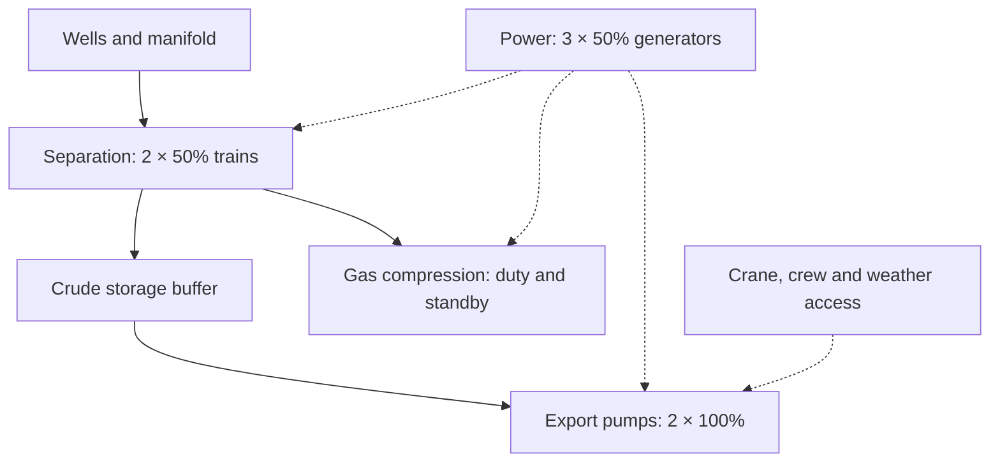

# RAM & Production Availability Modelling
## Engineering master specification · Revision A · 20 November 2026

Enhance Integration Engineering | Package: rammodel | Status: engineering baseline and M1 foundation. Owner decisions D01–D15 are approved. Revision B of DECISIONS.md governs the AI and model workflow. See DECISIONS.md, RAM_SOFTWARE_BENCHMARK.md, RISK_REGISTER.md and REQUIREMENTS_TRACEABILITY.md.

## 1. Purpose and limits

Model repairable systems, their ability to provide a defined service, and production consequences. The first qualification domain is onshore process facilities and offshore production. The same typed model should represent supported service, capacity and dependency patterns for utility, water, power and other assets; qualify each domain using an independent reference case before using a domain-specific label. Equipment lists alone can populate a register but cannot prove operating logic. Unsupported control behaviour, recycle, multi-product conversion or load sharing must be visibly flagged and excluded from quantitative runs until a qualified representation is available. A flow model represents agreed capacity and operating logic. Hydraulic, thermodynamic and electrical network studies require their own models. SIL/PFD is outside scope.

Methods informed by [ISO 20815:2026](https://committee.iso.org/standard/89174.html), [ISO 14224:2016](https://www.iso.org/standard/64076.html), [IEC 61078](https://webstore.iec.ch/en/publication/25647), [IEC 61165](https://webstore.iec.ch/en/publication/4721), [IEC 60300-3-1](https://webstore.iec.ch/en/publication/1294), and, for optional later extensions, [IEC 62551](https://webstore.iec.ch/en/publication/7191). [OREDA](https://oreda.com/standards-and-publications/) informs data-source metadata. Cite user-authorised OREDA records without shipping data. Publish a methods description and qualification scope with each release.

## 2. Architecture and model data

Python 3.12, PySide6, SQLite .ramcase with numbered transactional migrations, NumPy/SciPy, openpyxl, python-docx and a PDF writer. Keep the core model, engines and input adapters independent of Qt. Use stable object IDs, immutable run snapshots and a versioned typed schema. Store drawing artwork and engineering graph geometry separately from calculation semantics. Opening a newer unrecognised schema must fail safely. Audit edits and approvals with actor, timestamp and revision.

| Data group | Minimum records and constraints |
|---|---|
| Asset | System, nested subsystem, equipment tag and aliases, equipment class, operating context, stable IDs. Duplicate tags require explicit resolution within scope. |
| Evidence | Document/dataset hash and revision, filename, sheet/cell, page/region or graph object, original text/value and unit. Keep original evidence and derivation links when revising a mapping. |
| Failure model | Equipment, failure mode, operating or exposure basis, detection, proof-test interval as applicable, capacity loss, exponential rate or MTBF, or fully specified Weibull/lognormal parameters. Rate and MTBF must agree if both are provided on the same basis. Preserve numeric uncertainty bounds or error factor and its meaning. Missing is distinct from zero. |
| Restore model | Logistics delay, mobilisation, active repair, availability of crew and spares, weather constraints, commissioning or restart if explicitly modelled. Avoid counting the same delay twice. |
| Graph | RBD groups and members, equipment/state references, typed ports and flow edges, supply/demand schedule, routes and priorities, buffers, utility dependency edges, common-cause groups and resource rules. Store undefined connections as unresolved evidence. |
| Scenarios and results | Base and alternate snapshots, structured change lists, method and environment versions, input and code hashes, seed and stream policy, initial conditions, sample count, diagnostics, reported metrics and approval history. |

Every engineering value carries its source, units, provenance, uncertainty status and review state. Mark synthetic values EXAMPLE. Imports stage changes for review and support atomic apply and rollback. CSV/XLSX exchange must retain provenance and missing-value semantics. M1 establishes these contracts even where methods are scheduled later.

## 3. Document to model workflow

Start with CSV, XLSX and engineer-entered project descriptions. Add Word/PDF text, PDF drawings and scanned documents through separate adapters. Integrate machine-readable equipment, port and drawing evidence from Enhance Integration Engineering’s P&ID Reader via a versioned import contract, preserving the reader’s confidence and revision IDs. Ingest maintenance history as observations with exposure, failure and restoration evidence. Unit conversions and any estimates based on observations are produced by versioned calculation routines after the engineer approves the data basis. Test handling of duplicate work orders, censored observations and inconsistent outage codes before qualifying site-data fitting.

The import workspace shows source, proposed object, and proposed connection side by side. Resolve tag aliases, conflicts across revisions, shared utilities, standby roles, equipment boundaries and missing numerical inputs before approving the affected model. A PDF may contain a vendor duty point that differs from the normal operating capacity. Keep both values and ask the engineer which applies. A line crossing without a confirmed connection remains unresolved. A revised source creates a reviewable difference by object and field, including prior and proposed values and affected scenarios. Manual editing and import mapping remain available offline.

## 4. AI within the calculation and reporting workflow

Provide one typed tool interface for the UI, manual workflow and optional AI provider. The AI proposes source mappings, graph patches, candidate methods, experiment plans and scenario changes. Every new proposal has evidence references, confidence where applicable and an explanation of missing information. Show the proposed patch and its effect before applying. Read-only validation can run automatically. Baseline changes and batches of new experiments require engineer approval before execution. Never execute arbitrary AI-generated Python or SQL. Apply only supported structured actions. Keep provider calls optional; default to local operation with AI off until enabled. Record provider/model, prompt version, evidence IDs, proposals, test runs and engineer decisions for audit. Cloud mode requires explicit configuration and control over which project material is shared.

The assistant can ask the engine to check the baseline, run an eligible analytical cross-check, create a bounded sensitivity run, replay a high-loss replication, or quantify a reviewable option. Example request: “If we add a third 50% separator, what improves, and why?” The software compares scenarios against the same production target, uses matched random streams where feasible, reports paired change and uncertainty, and links a loss explanation to the recorded sequence. The approved numerical model, method eligibility rules and deterministic calculations under stored seeds govern every result. Draft runs with complete inputs can be watermarked; missing essential input blocks the affected calculation. AI cannot fill gaps with invented numeric reliability data.

The reporting engine builds tables, plots and all numeric fields from an immutable run snapshot. AI drafts the executive summary, assumptions narrative, scenario discussion and recommendations from structured evidence. Require result references and scenario IDs for quantitative claims. Render values from stored metric IDs, reject unsupported references or claims, and send narrative to an engineer for review. Final exports require a current reviewed snapshot and no unreviewed AI items. Use “Engineer-reviewed results – not independently verified” for reviewed exports. Use prominent DRAFT and/or EXAMPLE labelling where applicable. Present unresolved or nonconverged metrics explicitly. Export JSON, Excel, Word and PDF.

## 5. Engineering methods

- Analytical screening. Use steady-state independent series/parallel/k-out-of-n algebra only within its assumptions. Use a CTMC for qualified constant-rate standby transitions with explicit repair and switching policy. Identify Markov and fixed-duration restoration assumptions separately. For periodically tested hidden failures use the small-rate approximation lambda times tau divided by two under the stated renewal and detection assumptions, with additional test/repair terms only under their declared scheduling and restoration assumptions.
- Discrete-event simulation. Main method, independent replications with stored seeds, explicit initial state, time horizon and ordering of simultaneous events. Store versioned stream derivation per stable object and event type. Account for scheduled maintenance, partial capacity, failure and restoration, switchovers, logistics queues and buffer boundary events. Define time basis as calendar hours. For non-exponential failures, declare operating-age accumulation and the repair-age reset policy.
- Production. Solve flow against active capacities, explicit route/priority rules and mass balance. Model partial demand delivery when buffer stock or draw rate limits supply. Production efficiency compares delivered volume to nominal capacity over the reporting period. If an approved contractual or no-failure schedule is available, report it as a separate target-based measure with its own denominator. Distinguish throughput shortfall from volume recovered within the horizon. Document the rule and basis for classifying unrecovered shortfall and lost revenue. Reconcile beginning/ending inventory.
- Statistics. Start with 1,000 replications and allow expansion up to 100,000. Report lower-tail P10, P50 and P90 and a 95% confidence interval on the mean; label the percentile direction. Warn at the cap if the interval half-width is larger than 1% of the estimated mean. Define tolerances in engineering units for near-zero loss and use separate diagnostics for rare events, percentiles and paired differences. Clarify interval meaning when checking repeatedly. Separate stochastic run variability from the effect of uncertain input parameters.
- Criticality. Report traceable downtime and loss contributions, explicitly identify simultaneous contributors, reconcile any additive attribution to total loss, and distinguish an attribution from the modelled improvement when a failure mode is removed. Separate engineering judgement from measurements and highlight where low-quality evidence has a material effect on the decision.

## 6. Windows workspace

Panels: Sources and Import, Model, Review Queue, Study Cases, Results, and Report. Use one selected object and revision across all panels. Model provides editable hierarchical RBD, production flow, and utility/dependency views. Include automatic layout, manual pinning, search, breadcrumbs, zoom and overview. Pick an asset to inspect source evidence, failure models and run outputs. Overlay throughput, bottlenecks, unreviewed assumptions and the selected replication’s inventory and event timeline. Provide dashboard availability gauge, production profile, buffer plot, contributor Pareto, tornado and side-by-side design comparison. Preserve typed semantics if layout changes. Display stale status on applicable result panes and exports.

### Illustrative model display · synthetic topology

Solid edges carry product. Dashed edges represent a dependency. The model should show why each dependency is asserted and what happens when it is lost. These connections are synthetic and illustrate display semantics.

## 7. Verification and delivery

Build and verify M1–M8 in order. Add the requested independent known-answer calculations, adversarial imports, drawing review fixtures, resource contention and mass-balance tests. Verify both process and non-process supported cases and include a deliberately ambiguous drawing where the assistant must abstain. Test report claims using fixtures with conflicting scenario IDs, outdated results and fabricated claims. Benchmark with vendor or independently calculated examples where authorised, aligning mission, repair and reporting assumptions and documenting the differences. No test or vendor comparison has been run at this stage.

The synthetic offshore case includes wells/manifold, separation, export pumps, gas compression standby, generators, crude storage and crane/weather constraints. Include analytical and Monte Carlo results, comparisons, sensitivity, reports and screenshots. Use tools/run_tests.py, record Windows logs in TEST_RESULTS/, retain any failures, and supply setup.ps1 and run.ps1 using literal paths and argument arrays suitable for spaces and ampersands. Build a SHA256-manifested return ZIP and include PROJECT_STATE.md, CHANGELOG.md, USER_GUIDE.md, DEVIATIONS.md, NEXT_WORK_PROMPT.md and REVIEW_README.md. Obtain permission before any Git commit or push. The target installation folder is `C:\Users\Admin\OneDrive - Enhance Integration Engineering\Company\006 Calculation Methods\30 RAM`.
